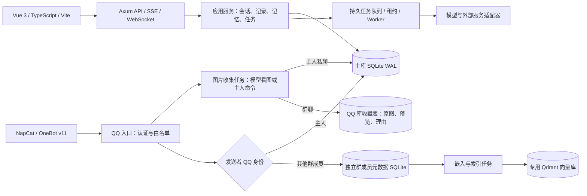

# 灵犀 v2：Rust + Vue

当前部署为 Rust 服务与 Vue 3 前端。Python v1 后端及旧测试已移除，历史实现可从 Git 提交 `2f8915f` 查看。保留的 Python 文件仅用于可选 AstrBot 插件、迁移导出和源码打包。

## 结构



| 层 | 代码 | 职责 |
|---|---|---|
| 界面 | `web/src/views`、`components` | Vue 单文件组件、路由、表单、流式对话、人物记忆 |
| 接口 | `backend/src/api.rs` | `/api/v2`、认证、SSE、WebSocket、公共网页沙箱 |
| 业务 | `records.rs`、`chat.rs`、`memory.rs` | 记录校验、版本并发控制、上下文压缩、长期记忆 |
| 队列 | `jobs.rs` | 持久化任务、跨进程领取、租约、取消、定时计划 |
| 接入 | `provider.rs`、`integrations.rs`、`media.rs` | 模型、搜索、图像、下载与存储 |
| QQ | `qq/` | 身份分流、群观察提取、向量索引、OneBot 回复、图片收藏 |
| 陪伴 | `companion.rs`、`companion/` | 时段与频率判断、模型决策、投递状态、通知渠道、QQ / AstrBot 私聊 |
| 数据迁移 | `migration.rs`、`migrations/` | 版本化 SQL 和 v1 导入 |

Vue 在构建时编译为静态资源，再嵌入 Rust 可执行文件，不需要额外的前端服务器。统一 Docker 镜像包含 Node 24 与飞书官方 SDK，由 Rust 管理账号对应的 SDK 子进程；未开启飞书时不启动这些子进程。Python 不参与应用运行。开发时 Vite 代理 Rust API。

## 主库记忆

短期上下文来自会话消息。超过预算时压缩旧的完整轮次，摘要和压缩边界一起提交；原始消息保留。流式回复被取消时保存已经生成的部分。

长期记忆按事实规范化去重，手动记忆优先。自动提取只增量更新，不整体覆盖记忆；删除留下墓碑，自动提取不能复活同一事实。记忆有来源、重要度和有效期。个人资料检索支持关键词与可选嵌入检索。

QQ 主人身份由设置中的数字 QQ 号决定。主人原始发言保存在主库 `qq_owner_events`，同时写入 `QQ 主人 · 群号` 会话；主人性格与偏好写入主库 `memories`。常规记忆整理跳过 QQ 群会话，改由专用提取器只选主人自己的发言，防止把对其他成员的讨论误记成主人特征。

## 群成员记忆

### 多群独立会话

`group_sessions`（QQ SQLite）按账号与群号唯一，保存固定会话 ID 和处理租约。旧白名单会在读取或接收消息时自动建立对应会话，无需迁移原文；移除群停止处理，重新添加沿用原会话。主人原文仍在主库，成员原文仍在群库；会话读取时按账号、群号合并展示，不复制到私人聊天。

`GET/POST /api/v2/qq/groups` 管理群列表，`PUT/DELETE /api/v2/qq/groups/{group}` 修改或移除单个群，`GET /api/v2/qq/groups/{group}/conversation` 展示最近 100 条记录。各群可独立暂停、指定模型和群人设，回复与观察开关可继承共用设置；配置更新采用比较并交换，避免并发覆盖。

Worker 使用数据库租约串行处理同群消息，不同群可以并行；上下文选用本群最近 12 条事件，包含已确认发送的助手回复。群人设与私人模型人设分开，群聊不加载私人记忆或工具。发送前再次检查群是否启用及配置是否改变，避免暂停后继续发出已生成的回复。

- 原始消息、观察及证据：`data/qq/people.sqlite3`，与主库物理分开。
- 向量：专用 Qdrant 服务、`lingxi_qq_*` 集合。集合名称含账户和嵌入配置摘要。
- 检索强制同时匹配账户、群号、QQ 号和有效期；返回结果再对照元数据校验所属人、版本、删除状态。
- 性格观察至少需要两条不同的本人消息；明确自述偏好可使用一条。引用必须能逐字匹配原始发言。保留置信度、来源和有效期，默认 180 天。
- 群成员原始消息默认保留 30 天。主人的对话不受这项清理影响。
- 删除立即影响应用检索，向量副本通过持久任务异步删除；失败可在人物页重新同步。
- 队列只保存消息或事实 ID，不把群成员原文复制到主库任务参数。

群聊回复使用当前群可见的上下文和当前成员的观察。即使发言者是主人，也不载入私人会话、个人工具或主库私密记忆，防止群聊泄露个人信息。

## 图片收藏

图片收集与人物记忆独立。主人私聊使用主库，群聊使用 QQ 库；两库分别有 `sticker_inbox`、`stickers` 和限流表，任务保存 ID 与显式 scope。图片来源加密保存，Worker 下载并校验格式、大小与像素数，再分别生成页面 PNG 缩略图和模型压缩输入。静态源文件与模型输入采用独立预算：32 MiB 原文件、3600 万像素、192 MiB 解码分配，模型图最长边 1024 像素、每张最多 384 KiB；透明图保留 PNG，大不透明图采用 JPEG 并按需降质。GIF 沿动画时间轴抽取最多 10 个不同帧（不足 10 帧则全部读取），每帧 PNG 同样限定 384 KiB，发送带原帧序号与时间标记的多图输入；首帧仍作页面缩略图，原 GIF 用于保存和回发。抽样保留 8 MiB 源文件与解码资源预算，不把未采样的中间内容说成已看过。非主人命令由视觉模型接收真实预览并输出结构化收藏判断，严格校验后决定保存；绑定主人的明确命令跳过模型。视觉调用不携带私人记忆、人物资料或工具。

原图、预览、收藏理由及处理状态在对应 SQLite 的同一事务中提交，按账户与内容哈希去重。限流计数持久化，各库收藏容量独立在写事务中检查。删除保留哈希墓碑，阻止自动收集复活；只有主人明确命令可恢复。周期恢复和手动重试衔接跨库队列，原图访问需账户认证。回复选图只接受当前会话收藏的 ID，私聊图库不能进入群聊候选，发送时再次核验来源和删除状态。

图片来源默认仅允许公网；部署允许内网时，也仅对与已配置 OneBot 地址同源的图片开放内网下载。跳转逐次校验，不向图片地址附带 OneBot Token。收藏图不参与人物性格提取，也不生成 Qdrant 向量。

私聊图片在 `qq_private_events.media` 中加密归档，视觉观察转换为有明确来源说明的聊天上下文。原图归档有每账号 256 MiB 密文预算；超额只保留来源与说明。纯图片识别失败使用明确提示，不调用文字模型猜图。养成忽略含图片事件，长期记忆提取从该私聊的原始文字收件箱取材，避开派生图片描述、模型回复和摘要。后续文字追问和会话压缩仍保留图片是引用数据的规则。

## 主动陪伴

主库迁移 `0004_companion.sql` 增加账号设置与租约 `companion_state`、决策记录 `companion_activity`、渠道投递 `companion_delivery`、私聊绑定 `private_bindings` 和 QQ 私聊收件箱 `qq_private_events`。设置默认关闭。Worker 每分钟协调到期计划，原子推进下一检查时间与入队；每个账号用数据库租约限制并发模型决策。

执行前按账号时区检查活动时段、免打扰、日程、聊天冷却、每日限额、主动消息间隔及未回复退避。上下文包含账号主库记忆和近期个人记录，使用所选模型与人设，禁用工具调用。B 站候选链接来自实际搜索结果，严格校验结构化输出与来源 ID。没有合适内容时保存安静决策。

模型返回后再次检查设置版本、租约和时间条件；内容哈希去重，活动及各渠道投递意图在同一事务中保存。发送前重新核对渠道目标与配置摘要，先写 `sending`，再执行外部请求。站内通知与成功会话记录事务提交；外部成功确认后只写入一次主库对话。未知结果不自动重试，关闭或配置更新取消待发项目，午夜清理当日未发内容。

AstrBot 绑定限制为一个账号一个私聊且目标全局唯一，v2 会话 ID 使用字符串。插件轮询领取带租约的消息，ACK 校验账号与租约并幂等提交；确认丢失时插件只重发 ACK，不重发消息。未确认的过期租约转为待核实。QQ 私聊只接受已配置的主人与机器人身份，原文及回复在主库，使用标准个人聊天与工具流程，群成员独立库不参与。

## 可靠性与边界

会话并发通过数据库租约协调，请求 ID 防重复执行。可能对外产生副作用的任务不盲目重试；QQ 发送前写入 `sending`，结果不确定时保留状态供核实。跨两个 SQLite 库的交接依赖幂等任务与周期恢复，不宣称跨库事务或外部消息严格 exactly-once。

密码 Argon2 哈希；Token 只存哈希；外部密钥 AES-GCM 加密，密钥文件独立保存。出站请求校验地址并固定 DNS 解析结果，默认阻止内网，私有模型、NapCat、Qdrant 需要管理员显式开启内网访问。

SQLite 适合单机、自托管和共享本机磁盘的多进程 Worker，不支持把同一个数据库文件放到 NFS 上跨机器并发写入。尚未进行生产负载基准测试。

## 开发

需要 Node 24 和 Rust 1.98（或使用 Docker）。

```sh
npm ci --prefix web
npm run build --prefix web
cargo test --workspace --locked
cargo run --bin lingxi -- serve
```

另一个终端运行 `npm run dev --prefix web`，默认把 API 代理到 `127.0.0.1:8000`。可用环境变量 `LINGXI_DEV_API` 指定其他 Rust 开发地址。Vite 默认仅监听本机。

```sh
npm test --prefix web
npm run check --prefix web
cargo fmt --all --check
```

Windows 需可用的 C/C++ 链接工具链；如果本机应用控制阻止 Cargo 生成的构建脚本，请使用 Docker 构建，不要降低系统防护。
